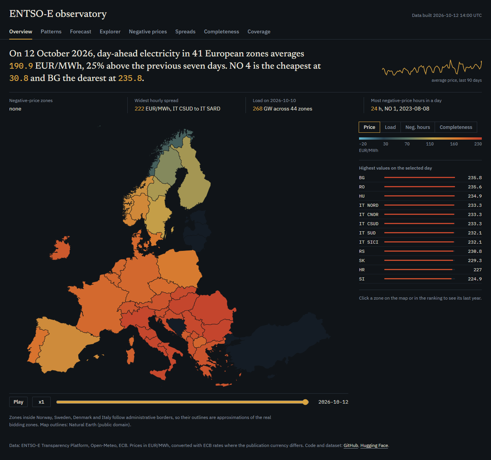
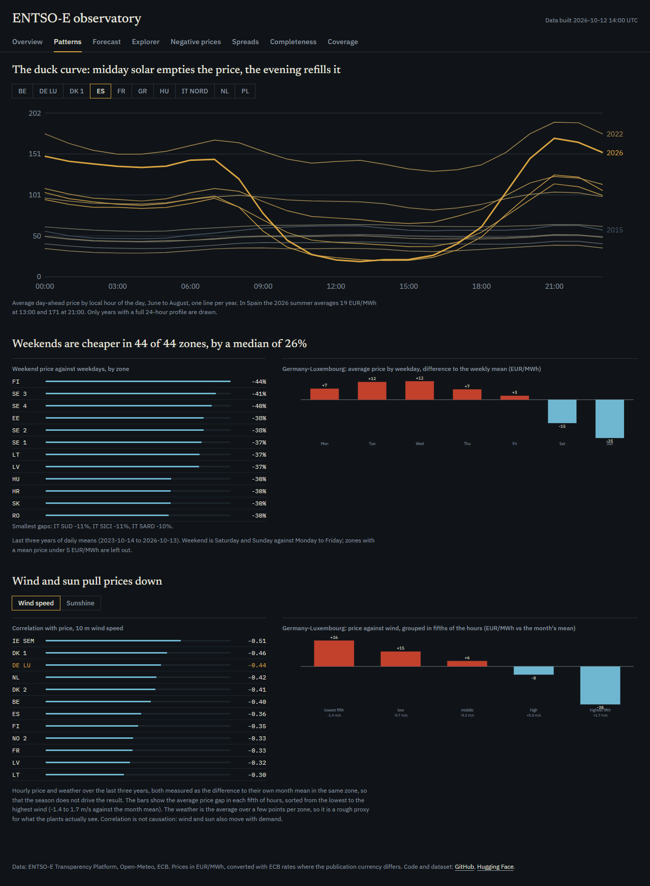
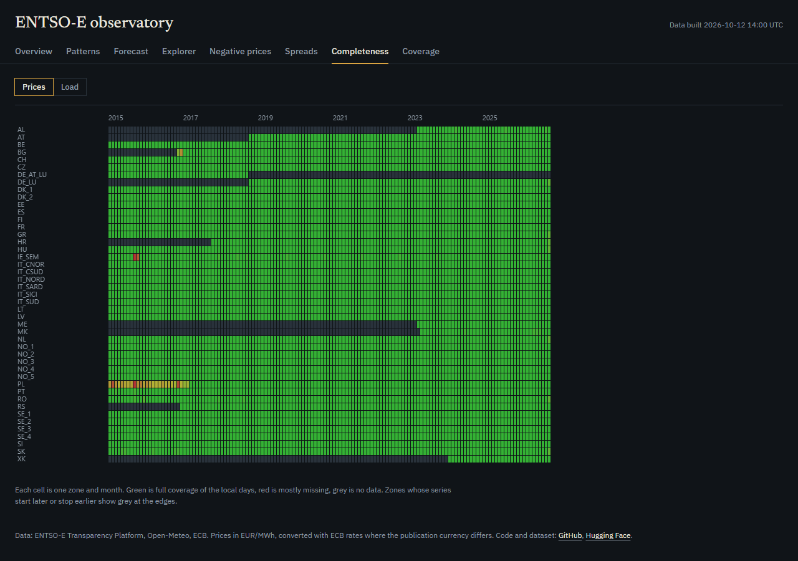
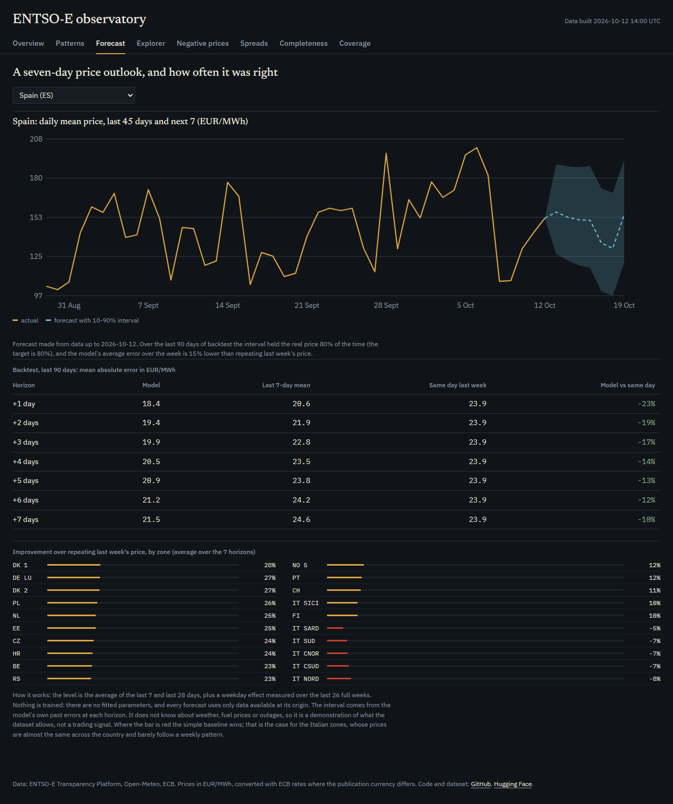

# entsoe-observatory

A reproducible, low-cost data platform for European electricity market data. It ingests day-ahead prices and actual total load from the [ENTSO-E Transparency Platform](https://transparency.entsoe.eu) for 51 bidding zones (2015 to today), adds per-zone weather and ECB exchange rates, checks the data with SQL quality rules, and publishes contract-enforced gold tables and a static dashboard. It runs on free tiers: GitHub Actions, Cloudflare R2 and Hugging Face.

The focus is data engineering: lineage, idempotent loads, data contracts and data quality. Forecasting as a product is out of scope: the dashboard has one small, transparent forecast as a demonstration, and the sibling project [energy-grid](https://github.com/hsilvosa/energy-grid) (local name `energy-predictor`) is the intended consumer of the gold layer for real modelling.

- **Dataset:** https://huggingface.co/datasets/hsilvosa/entsoe-observatory
- **Dashboard:** https://entsoe-observatory.pages.dev
- **Numbers:** about 14M silver rows (2015-2026), 9 gold tables (about 400 MB of Parquet), 51 zones, 3 scheduled workflows, 85 tests.



The dashboard also has an explorer per zone, negative-price and spread views, patterns (the midday solar dip, weekend and weather effects) and a seven-day forecast.



## What the data taught us

Building from the raw XML instead of an existing snapshot exposed problems that a normalized copy hides. Each one is covered by tests and an ADR.

| Finding | Effect | Handling |
|---|---|---|
| Every series uses `curveType=A03`: an omitted position repeats the previous value until the period end. | A parser that ignores it loses about 7.9 % of price slots and 6.2 % of load slots (291k rows for 2025 alone). | The parser expands each period and flags generated slots with `is_a03_filled` ([ADR 0004](docs/adr/0004-a03-curves.md)). |
| Mixed resolution: PT60M, PT30M and PT15M coexist. The 15-minute day-ahead market started on 2025-10-01, load switched per zone between 2021 and 2026. | Deduplicating on the timestamp merges series. | Business key is `(dataset, zone, timestamp_utc, resolution, sequence)`. Native tables keep the source resolution; hourly tables average and report `slots_present` and `slots_expected`; nothing is upsampled. |
| AT and DE_LU publish two price series. | 188k timestamps with conflicting values. | Sequence 1 is the SDAC auction; sequence 2 matches the 15-minute intraday auction ([ADR 0008](docs/adr/0008-sdac-sequence.md)). The choice is a field in the zone registry. |
| DST: local days have 23, 24 or 25 hours (92, 96 or 100 quarter hours). | Completeness checks with a fixed 96 slots flag every DST day. | Completeness is measured in covered minutes against the real length of each local day, per zone timezone. |
| PL, RO and BG changed currency during the history. | One EUR column would be wrong. | Price tables keep the publication currency; EUR conversion uses the ECB rate of the delivery date (latest rate up to 5 days old) and records the rate used. |
| Closed zones (DE_AT_LU) and windows over a year make the API answer HTTP 400. | A catch-up run would fail on one zone. | Closed zones are skipped, long windows are split, one failing zone does not stop the others. |

Reconciliation against the earlier snapshot: 608k more rows, none of the old keys lost.

## Architecture

```
ENTSO-E XML (A44 prices, A65 load) --+
Open-Meteo weather (per zone points) +--> landing (immutable files, sha256)
ECB FX reference rates --------------+          |
                                                 v
                      bronze: parsed rows, A03 expanded, lineage (source file, checksum,
                              document id, revision, run id)
                                                 |
                                                 v
                      silver: typed, validated, deduplicated on the business key,
                              newest revision wins, UTC + local time, quality flags
                                                 |
                      +--------------------------+-------------------------+
                      v                                                    v
          gold: nine tables with a JSON contract            DQ checks in SQL (dq/)
                      |
         +------------+-------------+
         v            v             v
     Cloudflare R2  Hugging Face  static dashboard
```

- **Engine:** DuckDB is primary; a Spark implementation of the silver logic is kept and checked for identical results by a parity test ([ADR 0001](docs/adr/0001-engine.md)).
- **Tables:** Hive-partitioned Parquet (zstd). Writes build the new partition next to the old one and swap it, so reruns are idempotent. Every run writes a manifest ([ADR 0002](docs/adr/0002-table-format.md)).
- **Contracts:** each gold table has a versioned JSON contract in `contracts/gold/`. The build enforces schema, nullability, grain uniqueness and row constraints before the table is swapped in ([ADR 0009](docs/adr/0009-gold-layer.md)). The event contract v2 is in `schemas/`.
- **Revisions:** the newest revision wins, and a snapshot can ignore revisions published after a cutoff time ([ADR 0005](docs/adr/0005-incremental-ingestion.md)).
- **Data quality:** 764 checks over the zones. Blocking: duplicates on the business key, units, currencies. Warning: completeness, ranges, freshness, FX coverage. Information: resolution and currency changes. Blocking failures fail the run ([ADR 0006](docs/adr/0006-data-quality.md)).



### Gold tables

`price_native`, `load_native`, `price_hourly`, `load_hourly`, `zone_daily`, `cross_zone_spread_hourly`, `weather_hourly`, `dq_scorecard`, `dq_scorecard_summary`. Columns, types and rules are in `contracts/gold/`, and the dataset card on Hugging Face is generated from them.

## Operations

| Workflow | Schedule (UTC) | What it does |
|---|---|---|
| `update-load.yml` | hourly | Pull load, save state. |
| `update-prices.yml` | 11:25 and 13:25 | Pull prices, FX and weather, run DQ, rebuild gold, publish to R2. |
| `weekly-dq.yml` | Monday 05:40 | Full DQ run, gold, publish, report as an artifact. |

Workflows share one concurrency group (a single writer). GitHub runners are empty, so each run restores bronze and silver from R2 and uploads only changed files ([ADR 0011](docs/adr/0011-orchestration.md)). A failing run opens a GitHub issue labelled `pipeline-failure`.

## Run it locally

Requires Python 3.12 and [uv](https://docs.astral.sh/uv/).

```
uv sync --extra dev
cp .env.example .env        # set STORAGE_ROOT, and ENTSOE_RAW_DIR for the history
uv run entsoe-observatory backfill   # raw XML -> bronze -> silver (about 7 minutes)
uv run entsoe-observatory pull       # incremental pull; needs ENTSOE_API_TOKEN
uv run entsoe-observatory dq
uv run entsoe-observatory gold
uv run entsoe-observatory dashboard  # static site in STORAGE_ROOT/site
uv run pytest
```

| Command | Purpose |
|---|---|
| `backfill`, `bronze`, `silver`, `landing` | Build layers from raw XML. |
| `pull` | Incremental pull from the ENTSO-E API. |
| `weather`, `fx` | Open-Meteo weather (`--resume` after a rate limit) and ECB rates. |
| `dq` | Data quality checks; exit code 1 on blocking failures. |
| `gold`, `dashboard`, `card` | Gold tables, static site, dataset card. |
| `publish-r2`, `publish-hf` | Publish (`--dry-run` first). Needs the `publish` extra. |
| `state-pull`, `state-push` | Pipeline state in R2, used by the workflows. |
| `reconcile`, `contracts` | Compare with a legacy snapshot; print the event contract schema. |

Measured on a Ryzen 7 5700X with 4 threads: full backfill 445 s (1.6 cores, 5.8 GB peak), gold build 103 s, DQ 118 s, a live pull of all zones about 150 s.

Linux and macOS work the same way. On Windows with Spark, unset `SPARK_HOME` for the process, set `HADOOP_HOME` to a folder whose `bin` holds `winutils.exe` and `hadoop.dll` (Hadoop 3.3.6), prepend that `bin` to `PATH`, and use a native Windows path for `PYSPARK_PYTHON`. Spark tests run with `pytest -m spark`.

Credentials come from the environment or `.env` (never committed): `ENTSOE_API_TOKEN` (or `ENTSOE_ENV_FILE`), `R2_ACCOUNT_ID`, `R2_BUCKET`, `R2_ACCESS_KEY_ID`, `R2_SECRET_ACCESS_KEY`, `HF_TOKEN`. Tokens are redacted from errors, logs and manifests, and tests check it.

## Cost

Running cost is 0 EUR per year on free tiers, with a hard cap of 20 EUR: GitHub Actions is free for public repositories, R2 gives 10 GB (the state and the dataset use about 1 GB), and Hugging Face hosting is free. The only recurring need is the free ENTSO-E API token.

## The forecast on the dashboard

A seven-day outlook for the daily mean price of each zone with enough history. The level is the average of the last 7 and last 28 days, plus a weekday effect from the last 26 full weeks. Nothing is trained and every forecast uses only data available at its origin; a test checks that changing future values does not change the result. The 10-90% interval comes from the model's own past errors at each horizon.

It is scored on the last 90 days against two baselines, the same day last week and the last 7-day mean, using mean absolute error per horizon, plus how often the real price fell inside the interval. In most zones it beats the weekly baseline by 10 to 28%, and the interval covers 74 to 84% of days against a target of 80%. It loses to the baseline in the five Italian zones, where prices barely differ across the country and follow no weekly pattern. It has no weather, fuel or outage inputs, so it is a demonstration of what the dataset supports, not a trading signal.



## Limitations

- Some gaps are real: PL has 697 days without a price, AL and CY have long load gaps, and IE_SEM publishes no load since 2025-10. The scorecard lists them.
- The sequence choice for AT and DE_LU is an inference from the data and the EPEX launch date, not an ENTSO-E statement.
- Weather is a population-weighted mean over a few points per zone. The free Open-Meteo tier stops large backfills, so the history for some zones loads over several days.
- The neighbour list for spreads is maintained by hand (`configs/neighbours.json`).
- The dashboard on Cloudflare Pages is redeployed by the daily workflow; a failed deploy raises the usual issue.
- The earlier Hugging Face dataset `hsilvosa/entsoe-day-ahead` has the A03 gap described above; this project does not touch it.

## Attribution and licensing

Data: ENTSO-E Transparency Platform (re-use requires naming it as the source and not implying endorsement), Open-Meteo (CC BY 4.0) and ECB reference rates. The published tables are derived works without warranty. Check ENTSO-E's list of data open for free re-use before redistributing.

Parts of the code are adapted from the author's earlier projects: `energy-predictor` (time handling, DST test cases, client conventions, event contract) and `entsoe-transparency` (XML parser structure, zone list, download manifest format).

## More

- `docs/adr/`: architecture decision records.
- `docs/phase0/` to `docs/phase3-results.md`: measurements and findings per phase.
